# M. Player

Offline desktop music player. **Electron · Vue 3 · shadcn-vue + Tailwind · Elysia (Bun) · SQLite.**


<table>
  <tr>
    <td width="50%"><br><sub>Now Playing, with a blurred-artwork backdrop</sub></td>
    <td width="50%"><br><sub>Browse by folder, breadcrumbs, play a whole folder</sub></td>
  </tr>
  <tr>
    <td><br><sub>Album page</sub></td>
    <td><br><sub>Queue panel (drag to reorder)</sub></td>
  </tr>
  <tr>
    <td><br><sub>Dark theme</sub></td>
    <td><br><sub>Playlists</sub></td>
  </tr>
  <tr>
    <td><br><sub>Songs: virtualised, sortable, filterable</sub></td>
    <td><br><sub>Albums</sub></td>
  </tr>
</table>

### Liquid-glass player bar
The player bar is Apple-style liquid glass: clear and lightly frosted (backdrop blur + saturation), with a bright specular rim and no
colour of its own. It picks up whatever scrolls behind it, in both light and dark.

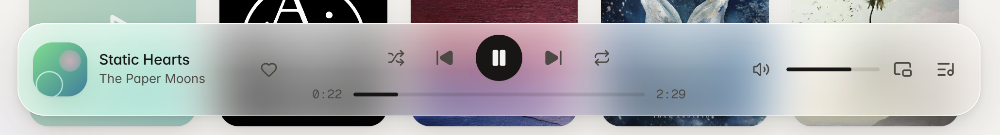

<table>
  <tr>
    <td width="50%">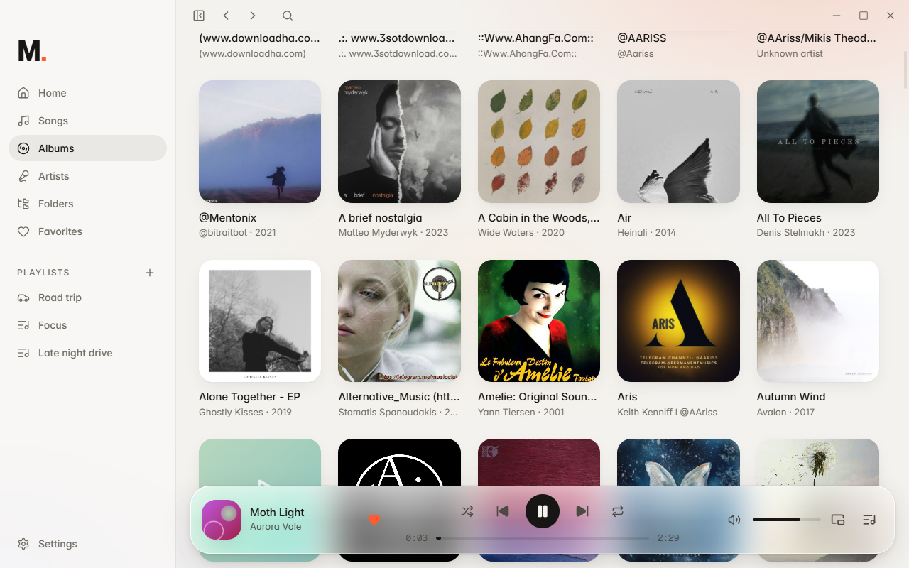</td>
    <td width="50%">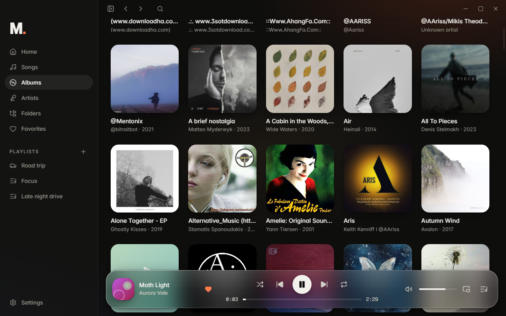</td>
  </tr>
</table>

### Persian / right-to-left
Switch the language in **Settings → Language**. The whole UI flips to RTL (sidebar, queue panel, lists, breadcrumbs) and uses
[Vazirmatn](https://github.com/rastikerdar/vazirmatn) (SIL OFL) with Persian digits and the Jalali date. Playback controls and the
seek bar deliberately stay left-to-right, as on every media player.

<table>
  <tr>
    <td width="50%"></td>
    <td width="50%"></td>
  </tr>
  <tr>
    <td></td>
    <td></td>
  </tr>
</table>

### Mini player
Always-on-top, stays above every other window so you can control playback without switching apps
(`Ctrl+Shift+M`, or the mini-player button next to the queue). While it is active the full player leaves the taskbar and
lives in the **system tray** next to the clock: click the tray icon to bring it back, or right-click for previous / play / next.

 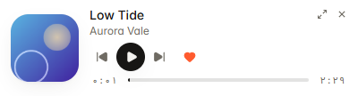

### Built for podcasts, audiobooks and big libraries
<table>
  <tr>
    <td width="50%">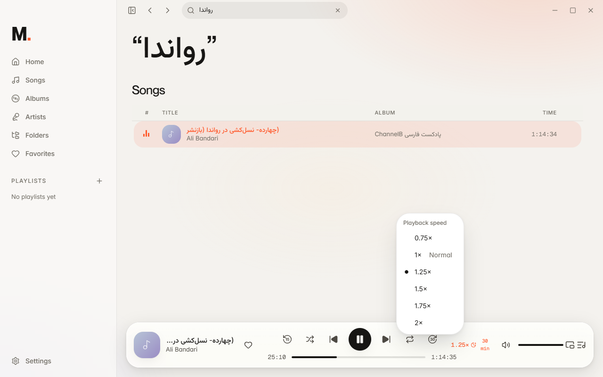<br><sub>Remembers where you stopped in long tracks (≥ 10 min), −15 s / +30 s buttons, speed 0.75×–2×, sleep timer</sub></td>
    <td width="50%">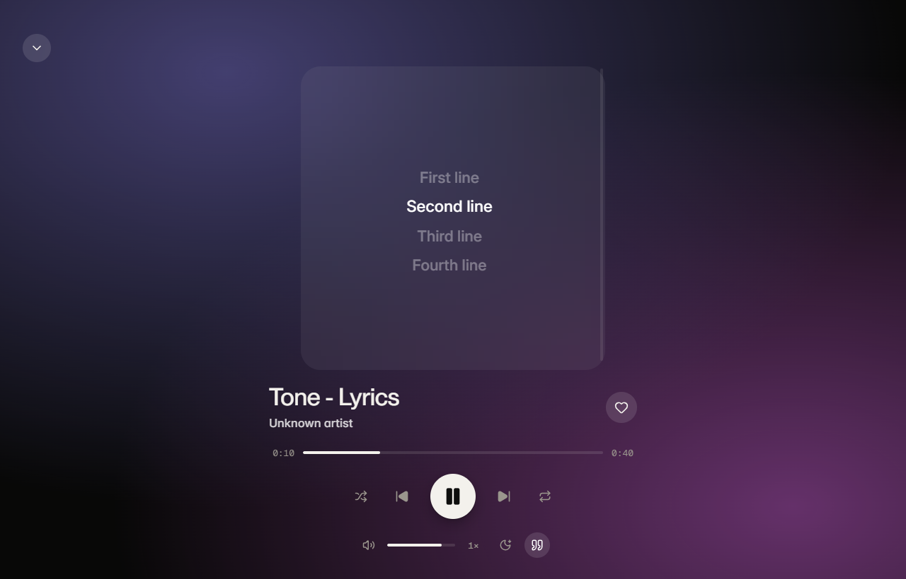<br><sub>Synced lyrics from a <code>.lrc</code> file next to the song (or embedded tags)</sub></td>
  </tr>
  <tr>
    <td>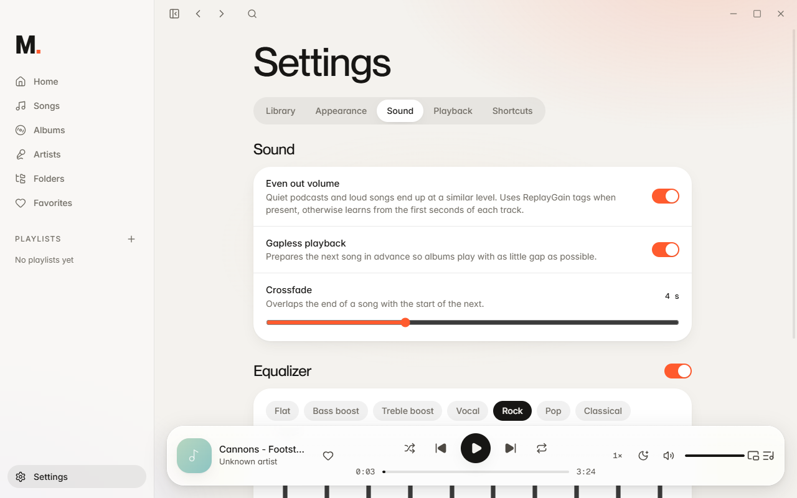<br><sub>Even out volume, gapless, crossfade and a 10-band equalizer</sub></td>
    <td>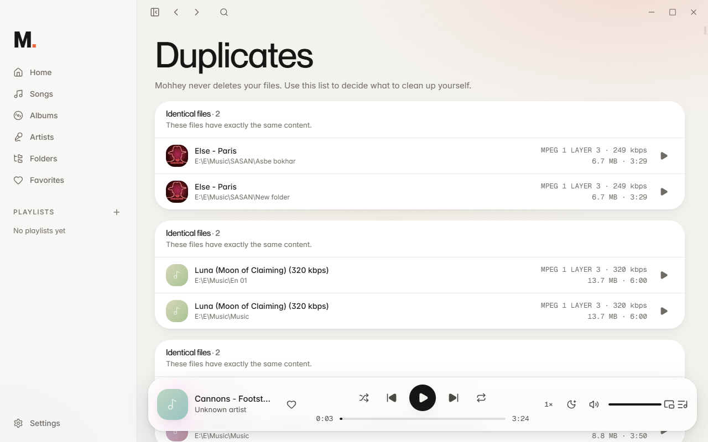<br><sub>Duplicate finder: identical files and "same song, different files"</sub></td>
  </tr>
  <tr>
    <td>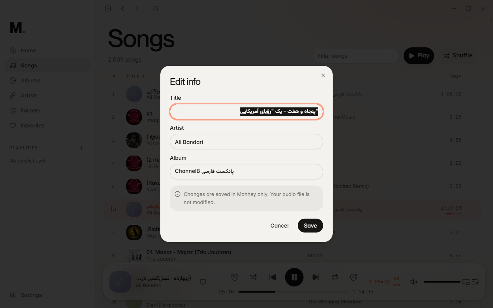<br><sub>Fix a title/artist/album inside Mohhey; the audio file is never modified</sub></td>
    <td></td>
  </tr>
</table>

### Small touches
<table>
  <tr>
    <td width="50%">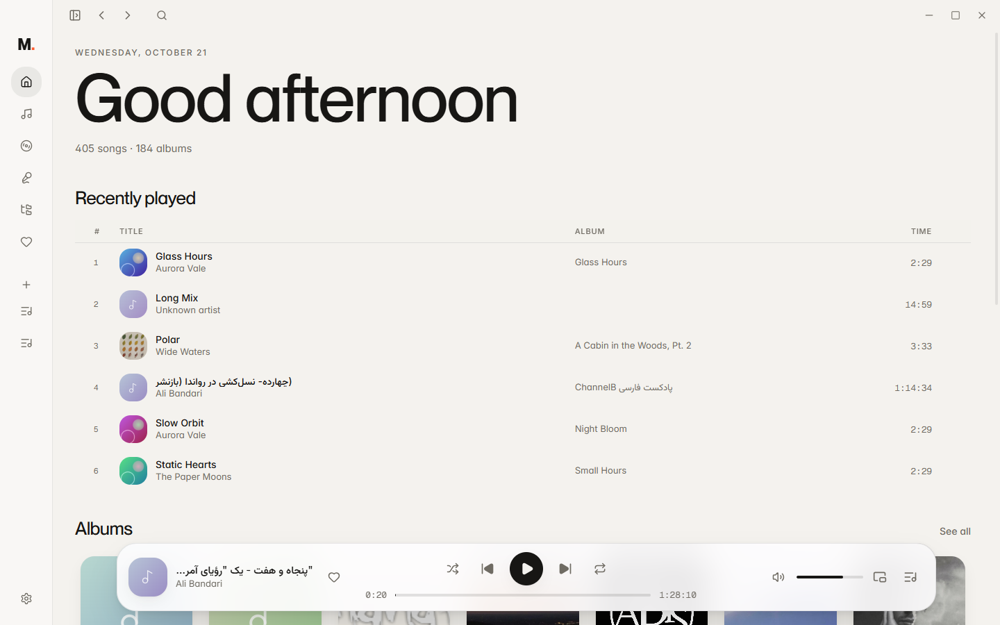<br><sub>Collapsible sidebar (`Ctrl+B`), icons only. Search is an icon until you click it (`Ctrl+K`).</sub></td>
    <td width="50%">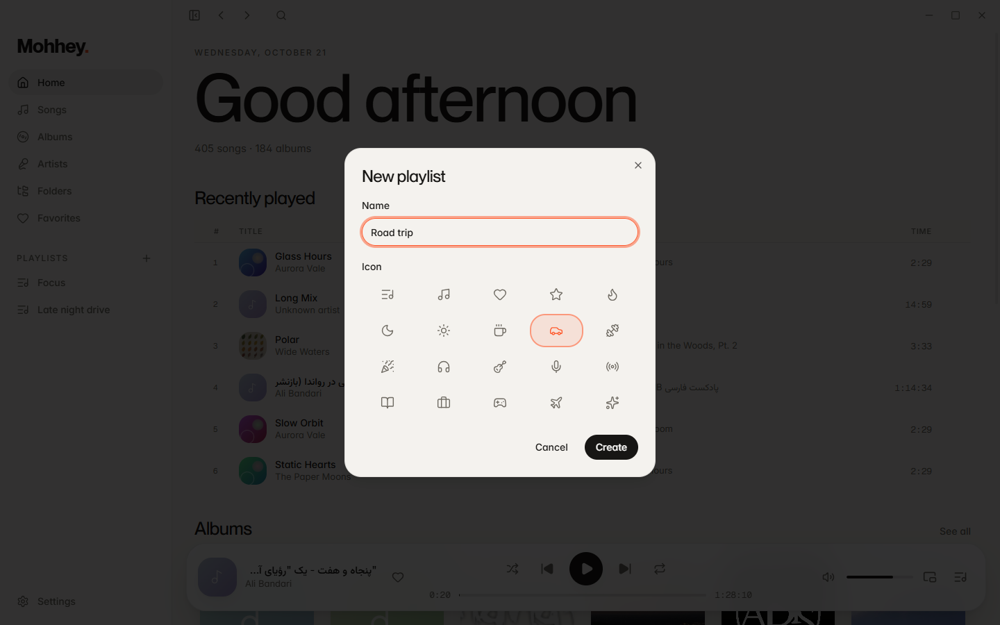<br><sub>Playlists have an icon, can be edited from the sidebar (hover or right-click) and deleted.</sub></td>
  </tr>
</table>

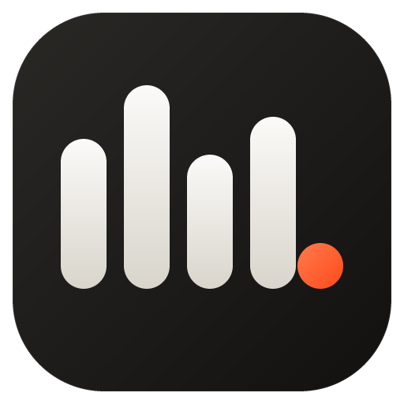 The logo is the "M." mark; source `apps/desktop/resources/icon.svg` (regenerate PNG/ICO with `bun scripts/make-icons.mjs`).

<sub>Screenshots use a small fictional library generated for the demo.</sub>

## Features at a glance
- **Resume** long tracks where you stopped; **speed** 0.75×–2× (pitch-preserving); **±15 s / 30 s** jump (`Shift+←/→`); **sleep timer** (15/30/45/60 min or end of track) with a slow fade-out.
- **Even out volume**: ReplayGain tags when present, otherwise a gain learned from the first seconds of each track (quiet podcasts vs loud songs).
- **Equalizer** (10 bands, presets), **gapless** preloading and real **crossfade** (two decks, equal-power overlap).
- **Lyrics** (`.lrc` sidecar or embedded), **Edit info** (kept inside Mohhey, never written to your files; restorable), **duplicate finder**.
- **Garbled tags are repaired automatically** (UTF-8 text that was stored as Windows-1252, e.g. Persian "Ø®Ùاصم" → "خلاصه…"), and the library rescans at start-up.
- Skipping fades smoothly; mini player lives in the tray; media keys / OS overlay via MediaSession (not verified on hardware).

## Build the installer (Windows)
```bash
cd apps/desktop
bun run dist          # → apps/desktop/dist/M-Player-Setup-<version>.exe
bun run dist:dir      # unpacked app only (faster, for testing)
```
`dist` compiles the API into a self-contained executable (`scripts/build-api.mjs`), builds the renderer, and packages everything with
electron-builder. The installer is a step-by-step wizard in the app's look (English / Persian): welcome → licence → install folder (you choose it) →
install → finish. It installs into `C:Program FilesM. Player` (64-bit; Windows asks for administrator approval once); uninstalling asks before removing library data. See [SECURITY.md](SECURITY.md).
`node scripts/checksums.mjs` writes `dist/SHA256SUMS.txt`. The installer is
unsigned, so Windows SmartScreen will warn until it is code-signed. No auto-update is configured on purpose.

## Smooth transitions
Skipping to the next/previous track (or picking another one) fades the current sound out (~0.2 s) and the new one in (~0.4 s) instead of cutting it off;
pause and resume have a short fade too. Pressing next several times skips several tracks and fades only once.

## Audio formats
MP3, **FLAC**, OGG/Opus, WAV, M4A/AAC and WebM audio: the formats Chromium can decode. FLAC was verified on real files from a library
(duration, tags, playback and seeking). Files are streamed with HTTP Range support, so seeking works on large files too.

## Requirements
Bun ≥ 1.2 on Windows, macOS or Linux.

## Run
```bash
bun run start      # one command: installs deps + Electron binary if needed, then launches the app
```
`bun run dev` does the same without the first-run checks.

Choose your music folder in the onboarding screen; scanning starts immediately.

## Scripts
| Command | What it does |
|---|---|
| `bun run typecheck` | contracts, API, renderer and Electron |
| `bun run test` | API (bun:test) and desktop (vitest) |
| `bun run build` | production bundles into `apps/desktop/out` |
| `bunx electron-vite preview` (in `apps/desktop`) | run the production build (custom `mohhey-app://` origin) |

Dev helpers: `MOHHEY_USER_DATA=<dir>` isolates the profile; `MOHHEY_DEBUG_PORT=<port>` opens CDP (never in packaged builds).

## Data and backup
Everything lives in `<userData>/data/`: `library.db` (+ `-wal`, `-shm`) and `artwork/`. Copy the folder to back up.
Settings → "Clear & rebuild" regenerates the artwork cache.

## Docs
`docs/architecture.md`, `docs/design-system.md`, `docs/decisions/`.

## Known limitations
- The installer is unsigned (SmartScreen warning) and has no auto-update; macOS/Linux packaging is configured but untested.
- Media keys and the OS "now playing" overlay use Chromium's MediaSession (state, position, seek and metadata are verified in-app); pressing physical keys is not verified on hardware.
- Gapless uses preloading of HTMLAudioElement: gaps are tiny but not guaranteed sample-accurate.
- Only English and Persian are translated; API error messages (e.g. validation) are still English.
