# Mohhey Player

Offline desktop music player. **Electron · Vue 3 · shadcn-vue + Tailwind · Elysia (Bun) · SQLite.**

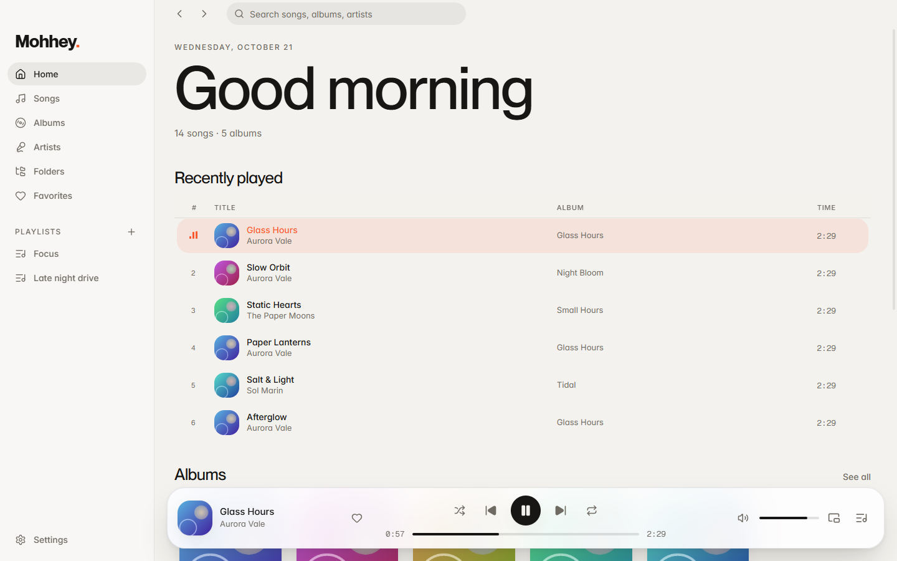

<table>
  <tr>
    <td width="50%">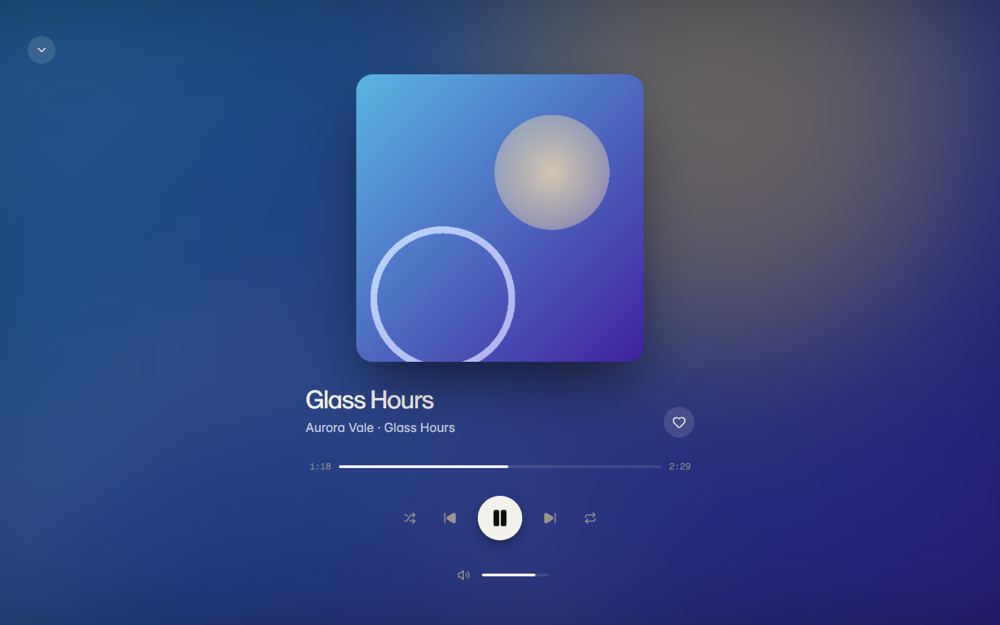<br><sub>Now Playing, with a blurred-artwork backdrop</sub></td>
    <td width="50%">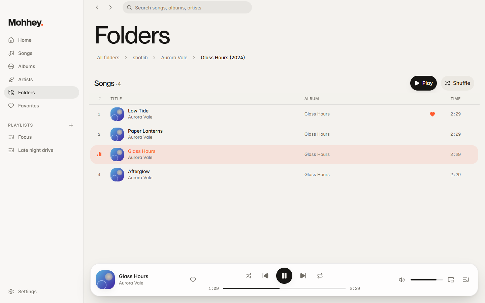<br><sub>Browse by folder, breadcrumbs, play a whole folder</sub></td>
  </tr>
  <tr>
    <td>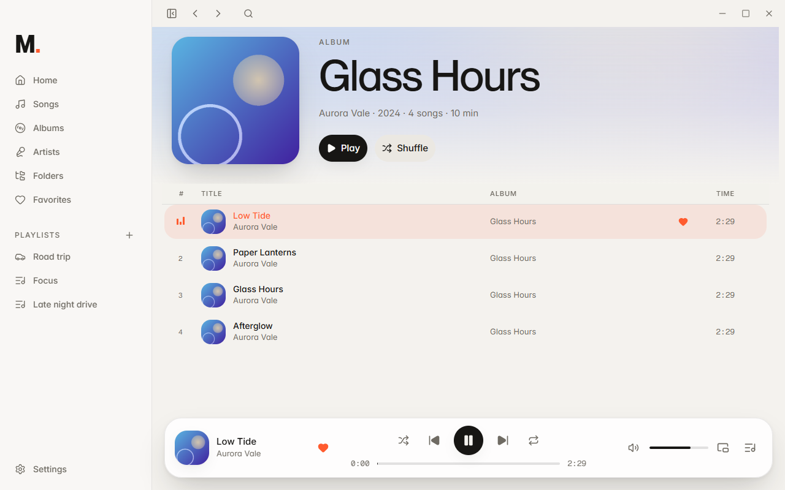<br><sub>Album page</sub></td>
    <td>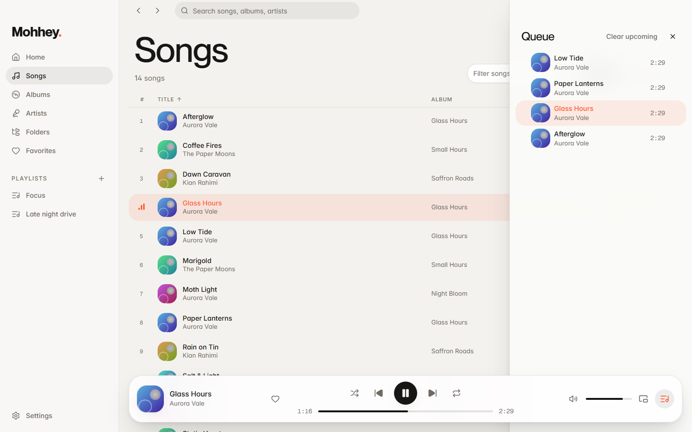<br><sub>Queue panel (drag to reorder)</sub></td>
  </tr>
  <tr>
    <td>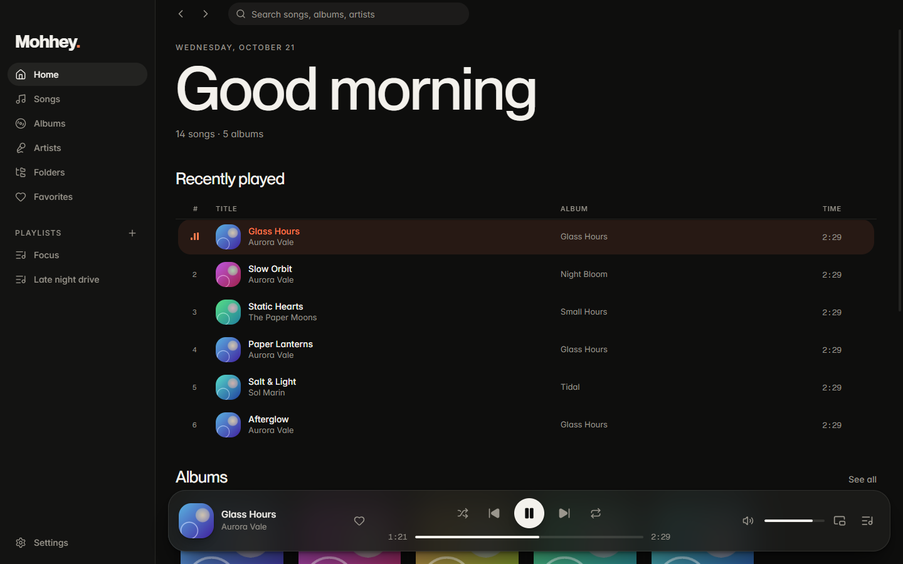<br><sub>Dark theme</sub></td>
    <td>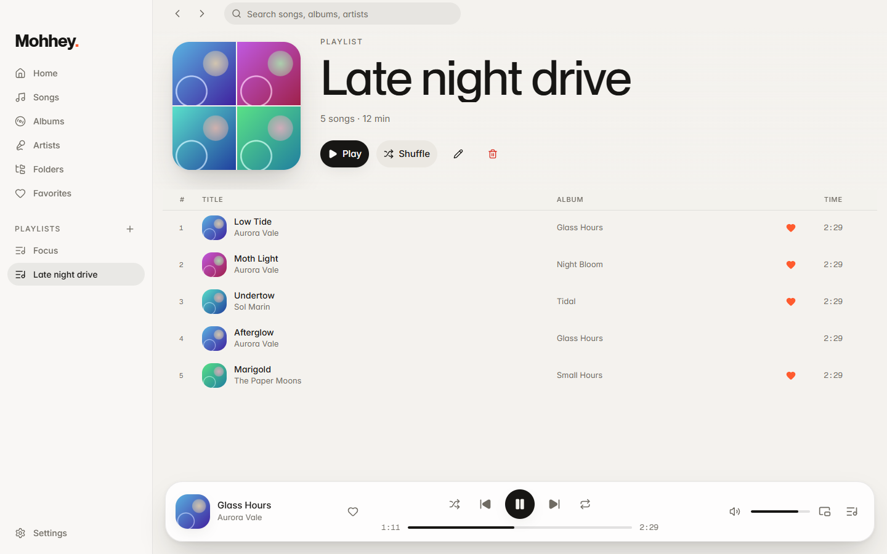<br><sub>Playlists</sub></td>
  </tr>
  <tr>
    <td>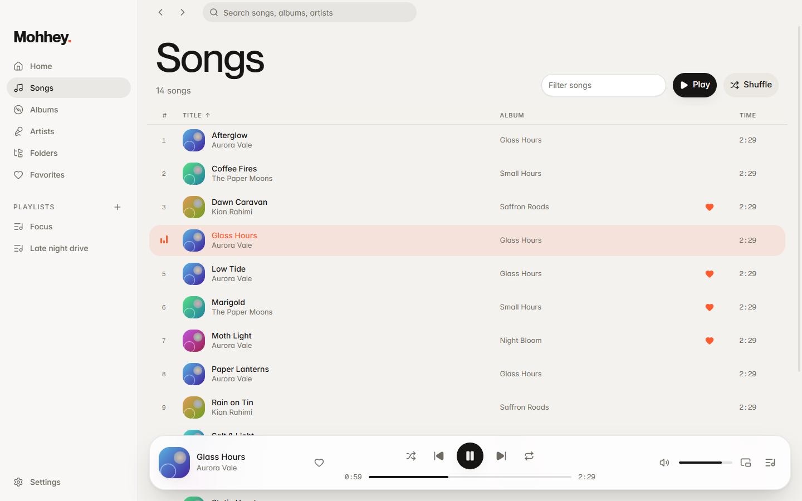<br><sub>Songs: virtualised, sortable, filterable</sub></td>
    <td>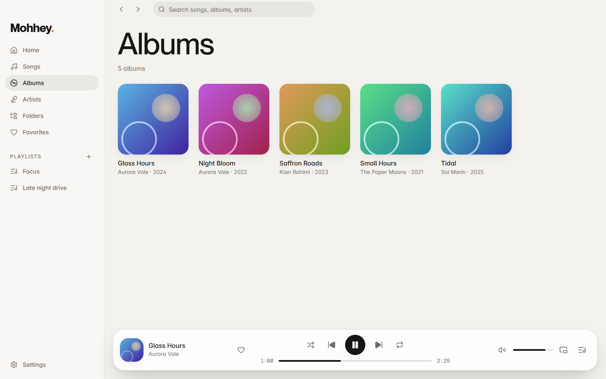<br><sub>Albums</sub></td>
  </tr>
</table>

### Persian / right-to-left
Switch the language in **Settings → Language**. The whole UI flips to RTL (sidebar, queue panel, lists, breadcrumbs) and uses
[Vazirmatn](https://github.com/rastikerdar/vazirmatn) (SIL OFL) with Persian digits and the Jalali date. Playback controls and the
seek bar deliberately stay left-to-right, as on every media player.

<table>
  <tr>
    <td width="50%">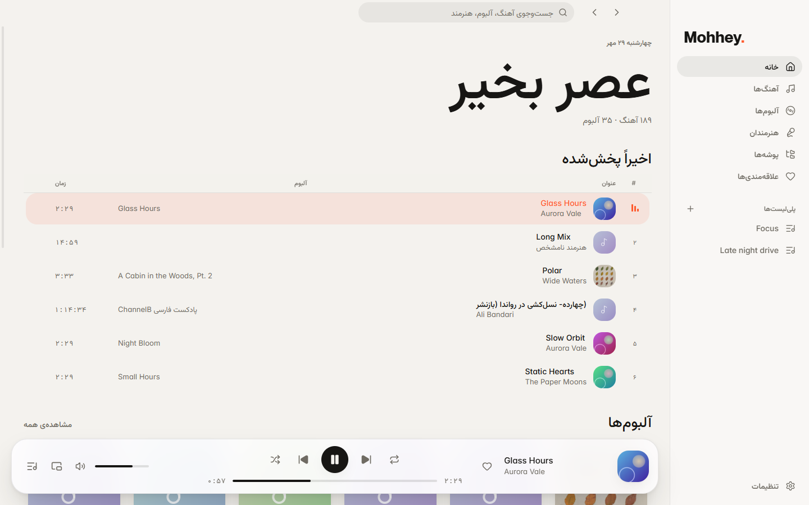</td>
    <td width="50%">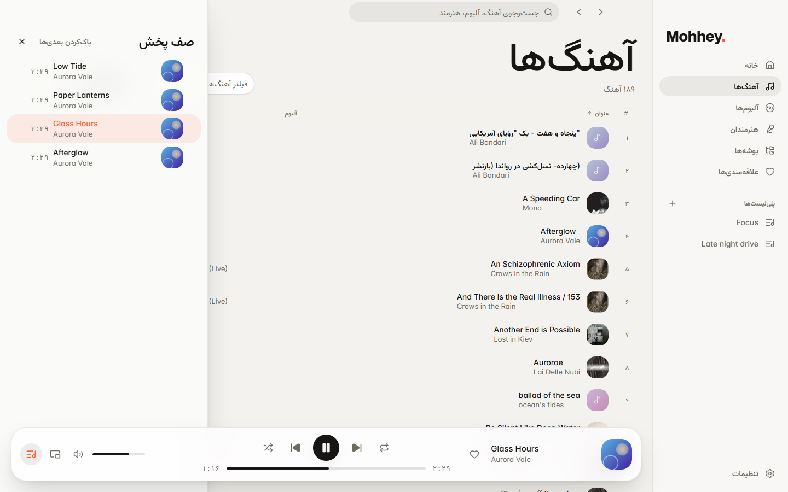</td>
  </tr>
  <tr>
    <td>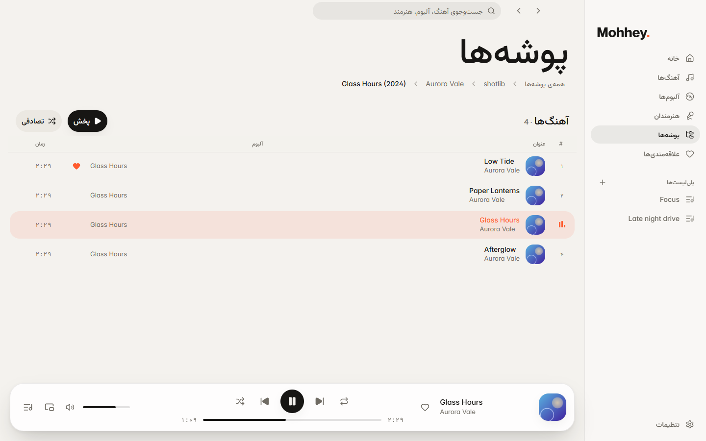</td>
    <td>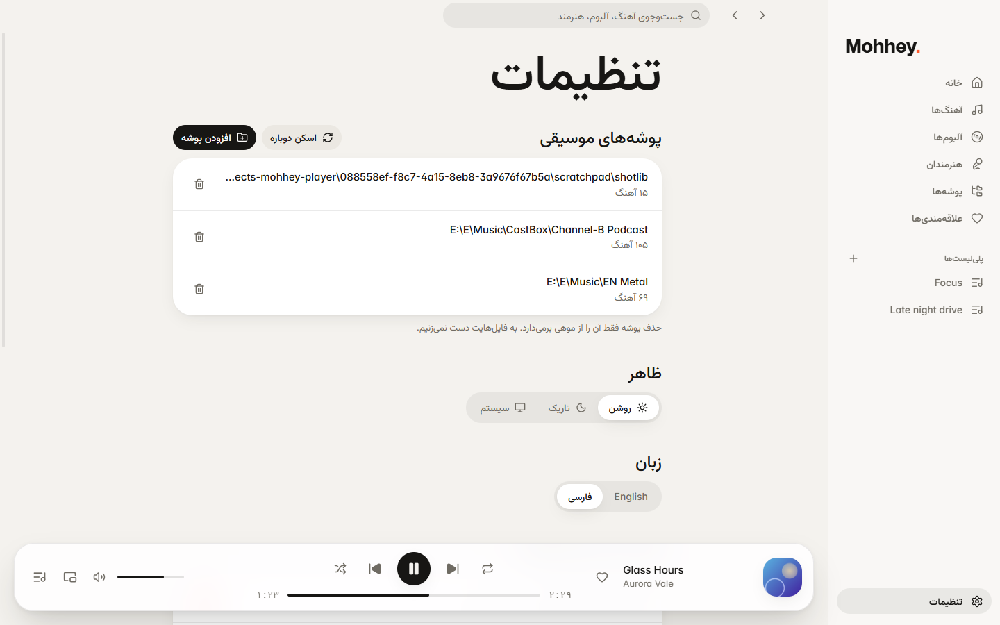</td>
  </tr>
</table>

### Mini player
Always-on-top, stays above every other window so you can control playback without switching apps
(`Ctrl+Shift+M`, or the mini-player button next to the queue).

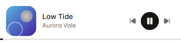

<sub>Screenshots use a small fictional library generated for the demo.</sub>

## Requirements
Bun ≥ 1.2 on Windows, macOS or Linux.

## Run
```bash
bun run start      # one command: installs deps + Electron binary if needed, then launches the app
```
`bun run dev` does the same without the first-run checks.

Choose your music folder in the onboarding screen; scanning starts immediately.

## Scripts
| Command | What it does |
|---|---|
| `bun run typecheck` | contracts, API, renderer and Electron |
| `bun run test` | API (bun:test) and desktop (vitest) |
| `bun run build` | production bundles into `apps/desktop/out` |
| `bunx electron-vite preview` (in `apps/desktop`) | run the production build (custom `mohhey-app://` origin) |

Dev helpers: `MOHHEY_USER_DATA=<dir>` isolates the profile; `MOHHEY_DEBUG_PORT=<port>` opens CDP (never in packaged builds).

## Data and backup
Everything lives in `<userData>/data/`: `library.db` (+ `-wal`, `-shm`) and `artwork/`. Copy the folder to back up.
Settings → "Clear & rebuild" regenerates the artwork cache.

## Docs
`docs/architecture.md`, `docs/design-system.md`, `docs/decisions/`.

## Known limitations
- No installer yet: packaging needs `bun build --compile` for the API plus electron-builder (see ADR 0002).
- Media keys and OS "now playing" use Chromium's MediaSession. Implemented, but not verified on real hardware.
- Equalizer, crossfade, gapless, lyrics and tag editing are deliberately deferred until the core is stable.
- Only English and Persian are translated; API error messages (e.g. validation) are still English.
